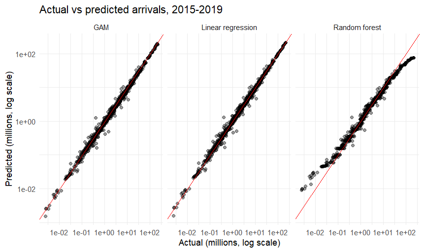

# Tourism Trend Analysis and Tourist Arrival Prediction Using R

Case study for **Introduction to Data Science using R**
(Artificial Intelligence and Data Science, CBIT, 2026-2027).

**Author:** Akshaya

## Problem

How can historical international tourist arrival data be analysed to identify
tourism trends and predict future arrivals?

## Objectives

1. Import and clean the raw data and document every change.
2. Identify the largest destinations and how concentrated tourism is.
3. Measure growth and compare trends across selected countries.
4. Quantify the effect of the 2020 pandemic (paired t-test).
5. Measure the relationship between last year's and this year's arrivals.
6. Predict arrivals with linear regression, a GAM and a random forest, and compare
   them using MAE, RMSE and R-squared.

## Dataset

World Bank, World Development Indicators: **International tourism, number of
arrivals** (`ST.INT.ARVL`), https://data.worldbank.org/indicator/ST.INT.ARVL

- Downloaded in R with the `WDI` package for all countries, 1960 to 2023
  (17,024 rows, 5 columns).
- After cleaning: 4,683 rows for 203 countries, 1995 to 2020.

## Files

| File | Description |
|---|---|
| `Tourism_Arrivals_Analysis.Rmd` | Full R Markdown: documentation, code, plots and results |
| `conclusion.md` | Detailed conclusion, observations and explanation of the plots |
| `figures/` | Saved plots from the analysis |

## How to run

1. Install R and RStudio.
2. Open `Tourism_Arrivals_Analysis.Rmd` in RStudio.
3. Click **Knit**. Missing packages (`dplyr`, `tidyr`, `ggplot2`, `scales`, `knitr`,
   `WDI`, `countrycode`, `mgcv`, `randomForest`) are installed automatically.
   An internet connection is needed the first time, to download the data. The
   data is then saved as `tourism_arrivals_raw.csv` next to the file.

## Results (test years 2015 to 2019)

| Model | MAE | RMSE | R-squared |
|---|---|---|---|
| Linear regression | 0.54 | 1.29 | 0.998 |
| GAM | 1.18 | 3.05 | 0.988 |
| Random forest | 3.89 | 15.5 | 0.679 |

MAE and RMSE are in millions of tourists. Linear regression scored best. See
`conclusion.md` for the full discussion and limitations.

## Version control

Work was committed in stages: initial analysis, preprocessing, visualization and
models, and final results and documentation.
